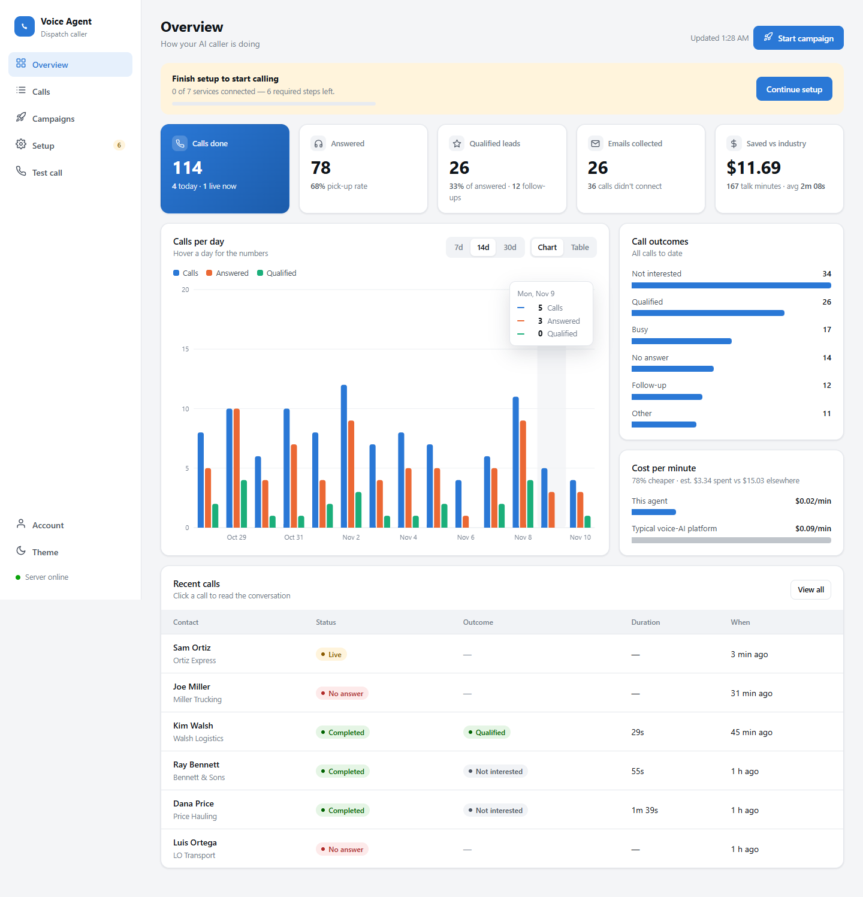
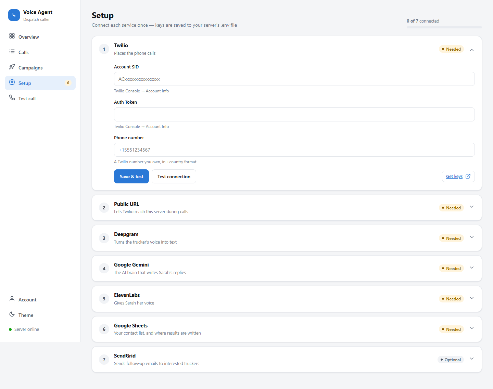
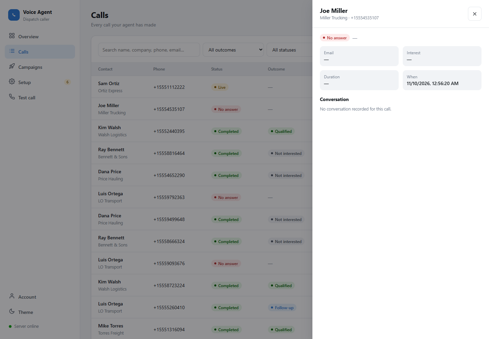

<div align="center">

# 📞 Voice Agent

### An AI cold caller for trucking dispatch that runs at a fraction of the usual cost

**~$0.02 / min** target cost, against the **~$0.09 / min** industry norm: **about 78% cheaper**


</div>

---

## What it does

Voice Agent dials truck drivers from a Google Sheet and has a natural, real-time phone conversation with each one. The agent ("Sarah") pitches dispatching services, handles objections and collects email addresses. After each call it qualifies the lead automatically, writes the results back to the sheet and sends a follow-up email to the leads that qualify.

```
Google Sheet ─▶ Campaign Dialer ─▶ Twilio call ─▶ live AI conversation ─▶ lead scored ─▶ Sheet updated + email sent
```

## 🖥️ Dashboard

A built-in web app for running everything from the browser, with no terminal or `.env` editing needed.



- **Overview**: calls done (today, and live right now), pick-up rate, qualified leads, emails collected, talk minutes, and **dollars saved against the industry rate**, plus a calls-per-day chart, outcome breakdown and recent calls. It refreshes every 10 seconds.
- **Calls**: searchable, filterable history of every call. Click one to read the AI summary and the full conversation, and send a follow-up email in one click.
- **Campaigns**: start, pause, resume and stop calling, with live progress.
- **Setup wizard**: connect Twilio, Deepgram, Gemini, ElevenLabs, Google Sheets and SendGrid one step at a time. Each step has a **Test connection** button that checks the key with the real service.
- **Test call**: call your own phone to hear the agent first.
- **Light and dark themes**, and a layout that works on phones.

| Setup wizard | Call detail |
|---|---|
|  |  |

**Secure by default:** the dashboard is password-protected (PBKDF2 hash, signed httpOnly cookie, login rate limiting). Until a password exists, it only answers requests from the server machine itself, so exposing the server through ngrok never leaves it open. Twilio's webhook and media-stream routes stay public, because Twilio needs to reach them.

## 💸 Why it's cheap

Most hosted voice-AI platforms charge around **$0.09 per minute**. This project builds its own pipeline from low-cost components and avoids extra processing steps, which brings the target down to about **$0.02 per minute**.

| Choice | Saving |
|---|---|
| **Gemini 2.0 Flash** for the LLM | Runs on the free tier, so the "brain" costs close to nothing |
| **ElevenLabs Flash v2.5 → `ulaw_8000`** | Produces audio in Twilio's own format, so there is **no transcoding** step |
| **Deepgram Nova-2 streaming** | Cheap, fast speech-to-text on raw 8 kHz μ-law audio |
| **Google Sheets as the database** | No Postgres, Redis or other paid infrastructure |
| **asyncio queues instead of Celery** | A single lightweight process, with no worker fleet or message broker |
| **Bring-your-own Twilio** | Each client pays its own telephony costs directly, with no markup |

## ⚡ Real-time pipeline

```
 Caller audio ──▶ Deepgram STT ──▶ Gemini LLM ──▶ ElevenLabs TTS ──▶ Caller audio
   (Twilio WS)     (streaming)     (streaming,      (streaming,       (Twilio WS)
                                    sentence-        μ-law 8 kHz)
                                    chunked)
```

- **Sentence-boundary chunking**: the first sentence is spoken while the LLM is still writing the rest, so the caller waits less.
- **Barge-in detection**: when the trucker interrupts, the agent stops talking, clears the queued audio and listens.
- **Auto-reconnect**: if the STT or TTS WebSockets drop, they reconnect with exponential backoff, up to 3 retries.
- **Personalised greeting**: the contact's name and company pass through Twilio → TwiML → WebSocket → the LLM prompt.
- **Post-call qualification**: Gemini pulls interest level, email, fleet size, objections, outcome and a summary from the transcript as structured JSON.

## 🧰 Tech stack

| Layer | Technology |
|---|---|
| Backend | Python 3.11+, FastAPI, asyncio |
| Speech-to-text | Deepgram Nova-2 (streaming WebSocket) |
| LLM | Google Gemini 2.0 Flash (streaming) |
| Text-to-speech | ElevenLabs Flash v2.5 (streaming WebSocket) |
| Telephony | Twilio Voice + Media Streams |
| Data | Google Sheets (gspread) |
| Email | SendGrid |
| Dashboard | Single-page HTML UI at `/` |

## 🚀 Quick start

```bash
git clone https://github.com/ahmedmustafakhan125-coder/voice-agent.git
cd voice-agent
pip install -r requirements.txt
cp .env.example .env
uvicorn app.main:app --host 0.0.0.0 --port 8000
```

Then open **http://localhost:8000** on the same machine:

1. **Create your dashboard password.** On first run this is only allowed from the server itself.
2. **Work through the Setup wizard.** Paste each key, click **Save & test**, and upload your Google service-account `.json`. The wizard shows which email to share your sheet with.
3. **Expose the server to Twilio.** For example, run `ngrok http 8000` and paste the `https://` URL into the *Public URL* step.
4. **Make a test call** to your own phone, then **start a campaign**.

Keys are saved to `.env` and take effect immediately, with no restart needed.

### Docker

```bash
cp .env.example .env
# Set DASHBOARD_PASSWORD in .env: inside a container, browser requests aren't "local"
docker-compose up --build
```

`data/` (call history) and `credentials/` are mounted as volumes, so they survive rebuilds.

## 📊 Google Sheet layout

| A | B | C | D | E | F | G | H | I | J | K |
|---|---|---|---|---|---|---|---|---|---|---|
| Name | Phone | Company | Status | Call SID | Duration | Interest | Email | Outcome | Summary | Called At |

`Status` values: `pending` · `calling` · `completed` · `failed` · `do_not_call`

## 🔌 API

| Method | Path | Description |
|---|---|---|
| `POST` | `/api/campaigns` | Start a calling campaign |
| `GET` | `/api/campaigns` | List campaigns |
| `GET` | `/api/campaigns/{id}` | Campaign status and stats |
| `POST` | `/api/campaigns/{id}/pause` | Pause a campaign |
| `POST` | `/api/campaigns/{id}/resume` | Resume a campaign |
| `POST` | `/api/campaigns/{id}/stop` | Stop a campaign |
| `POST` | `/api/calls/single` | Place a single test call |
| `POST` | `/api/email/send-followup` | Send a follow-up email |
| `GET` | `/api/stats` | Global stats |
| `GET` | `/api/dashboard/overview` | KPIs, cost vs industry, daily trend, outcomes |
| `GET` | `/api/calls` | Call history (`limit`, `offset`, `search`, `status`, `outcome`, `campaign_id`) |
| `GET` | `/api/calls/{sid}` | One call with its transcript |
| `GET` | `/api/setup/status` | Which integrations are configured (secrets masked) |
| `POST` | `/api/setup/{service}` | Save keys for one integration |
| `POST` | `/api/setup/test/{service}` | Live connection test |
| `POST` | `/api/setup/sheets/credentials` | Upload the Google service-account key |
| `GET` | `/api/auth/status` · `POST` `/api/auth/login` `/logout` `/setup` `/password` | Dashboard login |
| `GET` | `/health` | Health check (public) |

Every `/api/*` route except `/api/auth/*` requires a dashboard login.

## 🗂 Project structure

```
app/
├── main.py              # FastAPI entry point
├── config.py            # Settings loaded from .env
├── pipeline/            # session · stt · llm · tts · barge_in
├── telephony/           # TwiML, Twilio Media Stream WS, outbound calls
├── automation/          # Google Sheets + SendGrid
├── campaign/dialer.py   # Rate-limited async dialer (semaphore + pause/resume)
├── storage/call_log.py  # SQLite call history behind the dashboard numbers
├── core/                # Auth, .env writer, integration checks
└── api/                 # REST routes, dashboard, setup, auth, Twilio webhooks
static/index.html        # Dashboard web app (no build step)
tests/                   # pytest suite
```

## 🧪 Tests

```bash
pip install -r requirements-dev.txt
pytest
```

The tests cover the call log, the campaign dialer lifecycle, the dashboard and setup APIs (with external services mocked), authentication, and the dashboard page. A contract test checks that every API call the page makes points to a real route.

For a module-by-module walkthrough and fixes for common errors, see [DEBUGGING_GUIDE.md](DEBUGGING_GUIDE.md).

## 🔐 Configuration

All keys are listed in [`.env.example`](.env.example), and the Setup wizard fills them in for you. Each client supplies their own Twilio credentials, and none are hardcoded. The dashboard's cost figures come from `COST_PER_MINUTE` (default `0.02`) and `INDUSTRY_COST_PER_MINUTE` (default `0.09`).

---

<div align="center">
Built to make AI voice outreach affordable. ⭐ Star the repo if it saved you money!
</div>
